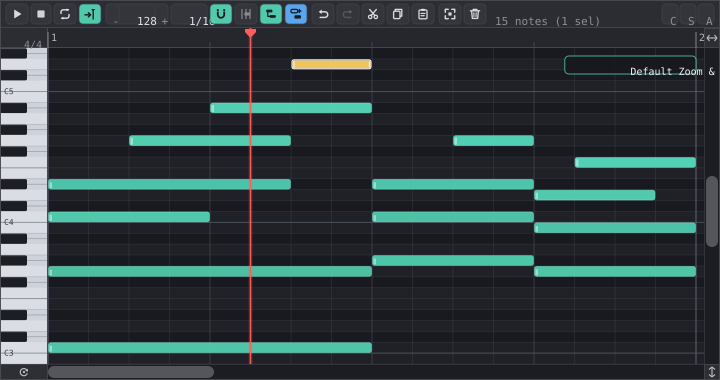

# `[pianoroll]` — DAW-Grade Interactive MIDI Piano Roll for Pure Data / plugdata

A modular, vector-rendered DAW piano roll GUI object for **plugdata** / **Pure Data** (`pdlua` + `LuaJIT 2.1` + NanoVG), featuring a 3-layer cached renderer, vector SVG toolbar icons with toggleable hover tooltips, FL-style Shift+Drag duplication, group time-stretch handle, polyphonic voice/list scheduling, dynamic shortest-bar Auto-Loop, and zero-dependency Standard MIDI File (`.mid` Type 0/1) import & export. Licensed under the [MIT License](./LICENSE).



---

## Features & Highlights

- **Vector SVG Chrome & 3-Layer Cached Renderer** (`pr_render.lua`, `pr_icons.lua`)
  - **Layer 1**: Toolbar, vector SVG controls, measure/beat ruler, 128-note vertical piano keyboard, adaptive bar/beat/subdivision grid, and scrollbars/zoom grips (repainted only on viewport/grid/state change for smooth panning even on dense scores).
  - **Layer 2**: Loop span highlight, velocity-shaded MIDI notes, sharp/flat row accents, pitch labels on zoomed notes, and real-time active key highlights.
  - **Layer 3**: Playhead cursor, Ctrl marquee selection box, multi-select `<->` time-stretch handle, inline edit tags, hover tooltips, and transient HUD callouts.
  - **Resize Invariance**: Fixed pixel toolbar (`28px`), ruler (`20px`), keyboard (`48px`), scrollbars (`16px`), and zoom grips stay proportional and crisp across arbitrary object dimensions (down to `160x120` minimum).
- **DAW Workflow & Non-Destructive Editing**
  - **4 Snap Modes**: Absolute Grid (`ABS`), Relative Offset (`REL`), Adaptive Zoom (`ADP`), and Visible Grid (`VIS`), plus hold `Alt` while moving notes, resizing note tails, or dragging the group stretch handle to temporarily bypass snap.
  - **3 New-Note Length Modes**: Last Clicked/Dragged Note (`LST`), Current Grid Step (`GRD`), and Fixed Beat Length (`1/4` .. `1` beat).
  - **FL-Style `Shift+Drag` Duplicate**: Dragging a note (or multi-selection) with `Shift` clones notes cleanly along with optional ghost start outlines.
  - **Multi-Select Group Time-Stretch (`<->`)**: Selecting 2+ notes displays a `<->` handle on the selection's right edge; dragging left/right scales the entire group proportionally anchored at the earliest note's start beat (snapped by default, `Alt+Drag` for free scaling).
  - **64-Step Undo / Redo & Clipboard**: Full history and copy/cut/paste/duplicate, accessible via toolbar icons, `Ctrl+Z/Y/C/X/V/D`, or **plugdata-safe single-key hover hotkeys** (`Z`, `C`, `X`, `V`, `D`, `Y`, `R` while pointer is inside the canvas).
- **Transport, Dynamic Auto-Loop & Synth Output** (`pr_playback.lua`)
  - **Space Return-to-Start** (on by default): Remembers where playback started and returns the playhead there when `Space` pauses/stops; **Stop** button (or `stop` message) rewinds playhead to `0.0`.
  - **Dynamic Shortest-Bar Auto-Loop** (on by default): When loop is enabled without an explicit custom range, automatically loops at the shortest complete bar boundary that finishes all MIDI notes cleanly (expanding/shrinking dynamically as you edit or import scores).
  - **Follow Playhead** (on by default): Smoothly scrolls/pages the viewport during playback while automatically backing off during manual scrollbars or zoom interaction.
  - **Dual Outlet Scheduling**: Outputs both individual polyphonic `noteon <pitch> <vel>` / `noteoff <pitch> 0` events + live `velocities` (Outlet 2) and sorted active pitch `list` snapshots (Outlet 1, ideal for `[else/synth~]`).
- **Standard MIDI (`.mid`) Import & Export + Starter Library** (`pr_midi.lua`, `midi/`)
  - Pure-Lua SMF Type 0 / Type 1 parser & encoder (with optional Windows UTF-8 `ffi` `kernel32` file I/O + `io.open` fallback — zero external C binaries to compile, `openpanel` / `savepanel` friendly).
  - Imports sync BPM, time signature numerator, sequence length, and reset stale custom loops back to Auto-Loop covering the imported piece. Multi-track Type 1 files expose an interactive track switcher pill (`ALL`, `T1`, `T2`, ...) and `midi_track` messages. Relative paths resolve against the patch folder and automatically fall back to the `[pianoroll]` object directory (so `midi/*.mid` loads from any patch).
  - Includes **5 ready-to-play public-domain MIDI scores** spanning Baroque, Classical, Impressionist, and Romantic Orchestral styles (both monophonic and multi-track polyphonic).
- **Theme Engine & Persistence** (`pr_theme.lua`)
  - Supports **Auto Host Colors**, **Dark**, **Light**, and **Custom** themes, tuned by default to match the release patch palette (`pianoroll_main.pd`). All state (notes, tempo, colors, zoom, view toggles) serializes directly into `.pd` patch arguments.

---

## Requirements & Quick Start

- **plugdata** `v0.9.x` (with built-in `pdlua` LuaJIT 2.1 + NanoVG support) or Pure Data with `pdlua` + NanoVG (`draw_svg`).
- The demo patch `pianoroll_main.pd` uses `[else/synth~]` (built into plugdata's ELSE library) for polyphonic audio auditioning.

### Running the Demo Patch

1. Open [pianoroll_main.pd](./pianoroll_main.pd) in **plugdata**.
2. Toggle **DSP ON**, enable the `[keyname]` `spigot` (already enabled on load in `pianoroll_main.pd`) so keyboard modifiers & hotkeys reach Inlet 4.
3. Click **Play** (or press `Space`) to hear the built-in chord progression, click `Import_MID` (or send `[import_midi midi/01_bach_minuet_in_g_poly.mid(` to Inlet 1) to load any score from [`midi/`](./midi), or click on the grid to compose directly.

---

## Architecture

| File | Responsibility |
| --- | --- |
| [pianoroll.pd_luajit](./pianoroll.pd_luajit) | `pd.Class` entry point, `[pianoroll]` arg serialization (51 positional header fields + sentinel extensions `-2`..`-6`), `in_1..in_4`, `out_1..out_4`, Inspector properties. |
| [pr_theme.lua](./pr_theme.lua) | Dark / Light / Custom / Auto-Host palette engine, velocity color derivation, `contrast_text`, grid contrast shading. |
| [pr_icons.lua](./pr_icons.lua) | Memoized vector SVG glyphs rendered via `g:draw_svg` (`play`, `pause`, `stop`, `loop`, `follow`, `ret_start`, `snap`, `snap_abs/rel/adp/vis`, `len_lst/grd/fixed`, `shift_dup`, `undo`, `redo`, `cut`, `copy`, `paste`, `fit`, `clr`, `time_stretch`). |
| [pr_layout.lua](./pr_layout.lua) | Resize-invariant layout geometry, coordinate transforms (`beat_to_px`, `pitch_to_py`), scroll thumb math, multi-select `<->` stretch handle box. |
| [pr_model.lua](./pr_model.lua) | Sorted note store, overlap sanitization, hit-testing, marquee selection, 4 snap modes, octave transpose, group stretch, 64-step undo/redo, dynamic Auto-Loop bounds. |
| [pr_playback.lua](./pr_playback.lua) | `pd.Clock` transport scheduler, polyphonic reference-counted voice map, `Space` return-to-start, `Stop` rewind to 0, follow-playhead tracking, live auditioning. |
| [pr_midi.lua](./pr_midi.lua) | Pure-Lua Standard MIDI File (`.mid` Format 0 & 1) decoder/encoder, tempo/time-signature parsing, relative path resolution, multi-track cache & switching. |
| [pr_render.lua](./pr_render.lua) | 3-layer NanoVG renderer (`paint`, `paint_layer_2`, `paint_layer_3`), SVG toolbar icons, hover tooltips, inline drag callouts, HUD badges. |
| [pr_input.lua](./pr_input.lua) | Mouse/drag state machine (create, move, duplicate, tail resize, group stretch, Alt-pan, Shift-zoom, ruler scrub/loop) and `[keyname]` hotkey dispatcher. |
| [pianoroll_main.pd](./pianoroll_main.pd) | Ready-to-run demo patch wired with `[keyname]`, MIDI Import/Export (`openpanel` / `savepanel`), track switching, and `else/synth~`. |
| [test_pianoroll.lua](./test_pianoroll.lua) | Offline 29-test regression suite executed via `pdlua-run.py` (protocol, DAW interactions, resize invariance, MIDI SMF roundtrip, starter scores). |
| [midi/](./midi) | 5 curated starter `.mid` scores (monophonic & 2-track polyphonic across multiple styles). |
| [LICENSE](./LICENSE) | MIT License text. |

---

## Default Palette & Appearance

Default colors match the pre-configured theme in [pianoroll_main.pd](./pianoroll_main.pd):

| Parameter | Default RGB / Value | Role |
| --- | --- | --- |
| `note_color` | `94, 133, 159` | Steel blue note body & active transport accent |
| `selected_color` | `189, 79, 81` | Warm crimson highlight for selected notes & handles |
| `playhead_color` | `192, 89, 107` | Rose-red playback cursor line |
| `loop_color` | `138, 139, 140` | Neutral slate loop span banner & range lines |
| `grid_color` | `96, 102, 114` | Slate grid lines (`grid_contrast = 0.5`) |
| `custom_bg_color` | `25, 27, 31` | Deep charcoal roll canvas (used with `Theme = Custom`) |

---

## Toolbar & Hover Tooltips

Hover over any icon, zoom grip, `[C][S][A]` badge, or the bottom-left reset corner to show a contextual tooltip (toggleable via Inspector **Show Hover Tooltips** or `tooltips 0|1`).

Left-to-right toolbar controls:

1. **Transport**: `Play / Pause [Space]` · `Stop & Rewind (0.0)` · `Loop` · `Follow Playhead` · `Space Return to Start`
2. **Tempo & Grid**: `[- BPM +]` (`Shift` = ±0.1, drag value up/down, double-click = `120`) · `Grid` (`1/1` .. `1/32`, `1/4T` .. `1/16T`) · `Snap` (magnet) · `Snap Mode` (`ABS` / `REL` / `ADP` / `VIS`) · `New Note Length` (`LST` / `GRD` / `1/4` / `1/2` / `1`)
3. **Editing**: `Shift+Drag Duplicate` · `Undo` · `Redo` · `Cut` · `Copy` · `Paste`
4. **View & Track**: `Fit All Notes` · `Clear All Notes` · `Track Pill` (`ALL`, `T1`, `T2`, ...; auto-appears on multi-track `.mid` import; click = next, `Shift+Click` = prev)
5. **Modifier Status Badges (`[C]` `[S]` `[A]`)**: Live indicator of `Ctrl`, `Shift`, `Alt` from `[keyname]`; clicking any badge also toggles a sticky lock as a mouse-only fallback.

Chrome corners & grips:
- **Bottom-Left Corner**: Click to reset zoom & pitch window to default (`reset_view`).
- **Top-Right Grip (`↔`)**: Drag left/right to zoom horizontally (double-click to reset H-Zoom).
- **Bottom-Right Grip (`↕`)**: Drag up/down to zoom vertically (double-click to reset V-Zoom).

---

## Mouse & `[keyname]` Controls

### Mouse Gestures

| Region | Gesture | Action |
| --- | --- | --- |
| **Roll (Blank)** | `Click` (or click & drag) | Create note snapped to grid (drag right/pitch while creating) |
| **Roll (Blank)** | `Ctrl + Drag` | Marquee box selection |
| **Roll (Blank)** | `Shift + Drag` | Continuous Zoom anchored at click point (drag L/R = H-Zoom, Up/Down = V-Zoom; no snap) |
| **Roll (Blank)** | `Alt + Drag` | Free 2D canvas pan (time & pitch) |
| **Note Body** | `Click / Drag` | Select note (or move entire multi-selection together) |
| **Note Body** | `Alt + Drag` | **Free unsnapped** note movement (`[FREE]` callout) |
| **Note Body** | `Double-Click` | Delete note (or delete entire active selection) |
| **Note Body** | `Ctrl + Click` | Toggle note in/out of selection |
| **Note Body** | `Shift + Drag` | FL-style duplicate & move (when enabled); `Shift + Click` without drag adds to selection |
| **Note Right Edge (Tail)** | `Drag` | Snapped note-length resize (applies to all selected notes) |
| **Note Right Edge (Tail)** | `Alt + Drag` | **Free unsnapped** note-length resize (`[FREE]` callout) |
| **Multi-Select `<->` Handle** | `Drag L/R` | Proportional **group time-stretch** anchored at earliest note start (`Alt + Drag` = unsnapped `[FREE]`) |
| **Top Ruler** | `Click / Drag` | Seek / scrub playhead (`Shift` = unsnapped) |
| **Top Ruler** | `Ctrl + Drag` | Define custom loop region (`loop_start` .. `loop_end`) |
| **Top Ruler** | `Double-Click` | Clear custom loop range (returns to dynamic Auto-Loop if enabled) |
| **Piano Keyboard** | `Click / Drag` | Audition pitch / glissando (`noteon`/`noteoff`) |

### Keyboard Shortcuts (`[keyname]` -> Inlet 4)

Connect `[keyname]` -> `[pak f s]` -> Inlet 4 (or send `key <0|1> <keyname>` to Inlet 1):

| Shortcut | Action |
| --- | --- |
| `Space` | Play; or pause / return to play-start position (when Return-to-Start is enabled) |
| `Ctrl + Up` / `Ctrl + Down` | Transpose selected notes `+12` / `-12` semitones (±1 octave) |
| `Delete` / `BackSpace` | Delete selected notes |
| `Escape` | Clear selection / cancel current drag |
| `Ctrl + Z` / `Z` *(hover)* | Undo (up to 64 steps) |
| `Ctrl + Shift + Z` / `Ctrl + Y` / `Shift+Z` / `Y` / `R` *(hover)* | Redo |
| `Ctrl + C` / `C` *(hover)* | Copy selected notes |
| `Ctrl + X` / `X` *(hover)* | Cut selected notes |
| `Ctrl + V` / `V` *(hover)* | Paste notes at playhead |
| `Ctrl + D` / `D` *(hover)* | Duplicate selection immediately after its span |
| `Ctrl + A` / `Alt + A` | Select all notes |

> **plugdata-safe Hover Hotkeys**: In plugdata's patch editor, `Ctrl+Z/C/V/X` are intercepted by the host undo/clipboard unless keyboard focus is bypassed. With `Single-Key Hover Hotkeys` enabled (default `ON`), hovering the pointer inside `[pianoroll]` lets single keys `Z`, `Y`, `R`, `C`, `X`, `V`, `D` act directly without competing with plugdata's host shortcuts (toggle off anytime via `hotkeys 0` or Inspector).

---

## Starter MIDI Library ([`midi/`](./midi))

Five curated public-domain MIDI scores are included in `pianoroll/midi/` covering multiple musical eras and genres. Monophonic files have strictly zero note overlap (`end_i <= start_{i+1}`) so they drive single-voice monosynths cleanly; polyphonic files use **2 named Type-1 tracks** (`Melody` + `Accompaniment`) for instant multi-track auditioning and soloing.

| File | Piece & Origin | Style | Polyphony | Tracks | Time Sig / BPM | Bars (Beats) | Notes |
| --- | --- | --- | --- | --- | --- | --- | --- |
| [01_bach_minuet_in_g_poly.mid](./midi/01_bach_minuet_in_g_poly.mid) | Minuet in G major — J. S. Bach / Christian Petzold | Baroque Minuet | **Polyphonic** | 2 (`Melody_RH`, `Bass_LH`) | `3/4` · `112` BPM | 16 bars (`48.0b`) | 91 |
| [02_bach_cello_prelude_mono.mid](./midi/02_bach_cello_prelude_mono.mid) | Cello Suite No. 1 Prelude (BWV 1007) — J. S. Bach | Baroque Arpeggio | **Monophonic** | 1 (`Cello_Solo`) | `4/4` · `78` BPM | 4 bars (`16.0b`) | 64 |
| [03_beethoven_fur_elise_poly.mid](./midi/03_beethoven_fur_elise_poly.mid) | Für Elise (WoO 59, Opening) — L. van Beethoven | Classical / Romantic | **Polyphonic** | 2 (`Right_Hand`, `Left_Hand_Arp`) | `3/4` · `128` BPM | 9 bars (`27.0b`) | 53 |
| [04_satie_gymnopedie_no1_poly.mid](./midi/04_satie_gymnopedie_no1_poly.mid) | Gymnopédie No. 1 — Erik Satie | Impressionist Waltz | **Polyphonic** | 2 (`Melody_RH`, `Chords_LH`) | `3/4` · `76` BPM | 8 bars (`24.0b`) | 42 |
| [05_grieg_mountain_king_mono.mid](./midi/05_grieg_mountain_king_mono.mid) | In the Hall of the Mountain King — Edvard Grieg | Orchestral Romantic | **Monophonic** | 1 (`Bassoon_Lead`) | `4/4` · `132` BPM | 8 bars (`32.0b`) | 52 |

Example messages to Inlet 1 (relative paths resolve automatically from the patch/object folder):

```text
[import_midi midi/02_bach_cello_prelude_mono.mid(
[import_midi midi/01_bach_minuet_in_g_poly.mid(
[import_midi midi/03_beethoven_fur_elise_poly.mid 1(   <- import Track 1 only
[midi_track next(                                       <- cycle ALL -> T1 -> T2
[export_midi my_pattern.mid(                            <- write Standard MIDI Type 1
```

---

## Inlets & Outlets Reference

### Inlets (4 Control Inlets)

- **Inlet 1 — Transport, Edit, MIDI, View & Styling**:
  - **Transport**: `bang` / `space` / `toggle` (play/pause or return-to-start), `float` (`0` = stop & rewind, non-zero = start), `play` / `start`, `pause`, `stop` / `reset` (stop & rewind to `0.0`), `seek <beat>`, `seek_sec <sec>`
  - **Timing & Grid**: `bpm <20..300>`, `timesig <1..16>`, `length <beats>`, `bars <n>`, `grid <div|idx>` (`1/1`..`1/32`, `1/4T`..`1/16T` or `1..9`), `snap <0|1>`, `snap_mode <1..4|abs|rel|adp|vis>`, `len_mode <1..5|last|grid>`, `vel <1..127>`
  - **Playback Modes**: `loop [en] [start end]`, `clear_loop` / `loop_clear`, `follow` / `follow_playhead <0|1>`, `return_start` / `return_to_start <0|1>`
  - **Notes & Editing**: `add` / `note <pitch> <start> [len] [vel]`, `set_notes <p s l v ...>`, `remove <id|pitch start [eps]>`, `delete_selected`, `clear`, `transpose <semitones>`, `quantize [strength]`, `select_all`, `deselect`, `undo`, `redo`, `copy`, `cut`, `paste [beat]`, `duplicate` / `dup`
  - **UI & Input Toggles**: `tooltips` / `show_tooltips <0|1>`, `hotkeys` / `single_key_hotkeys <0|1>`, `shift_dup` / `shift_drag_dup <0|1>`
  - **Query & View**: `get_notes` / `dump`, `get_active`, `get_state`, `resize <w h>`, `fit`, `reset_view`
  - **Appearance**: `theme <1..4|auto|dark|light|custom>`, `grid_contrast <0.25..2.0>`, `note_color <r g b>`, `selected_color <r g b>`, `playhead_color <r g b>`, `loop_color <r g b>`, `grid_color <r g b>`, `custom_bg_color <r g b>`
  - **MIDI & Keys**: `import_midi` / `load_midi <path> [track]`, `export_midi` / `save_midi <path>`, `midi_track` / `track <0|all|next|prev|N>`, `key <pressed> <keyname>`, `reset_keys`
- **Inlet 2 — BPM Control**: `float <bpm>`, `bpm <bpm>`, `tempo <bpm>`, or `bang` (emits current `bpm` on Outlet 3)
- **Inlet 3 — View, Scroll & Zoom Control**: `float <beat>` / `goto <beat>`, `scroll <beat> [pitch_top]` / `view <beat> [pitch_top]`, `zoom <ppb>` / `hzoom <ppb>`, `vzoom <ppp>`, `goto_pitch <pitch>`, `fit`
- **Inlet 4 — `[keyname]` Keyboard Stream**: `[pressed keyname]` or `[keyname pressed]` lists (`[keyname] -> [pak f s]`), plus `mods`, `reset_keys`

### Outlets (4 Control Outlets)

- **Outlet 1 — Sorted Active Pitch List**: `list <p1> <p2> ...` on every note-on/note-off change, and empty `list` on stop (connects directly to polyphonic synths such as `[else/synth~]`).
- **Outlet 2 — Polyphonic MIDI Events**: `noteon <pitch> <vel>`, `noteoff <pitch> 0`, `velocities <v1> <v2> ...` (emitted just before Outlet 1).
- **Outlet 3 — Transport Status**: `playing <0|1>`, `pos <beat> <sec> <bar> <beat_in_bar>`, `bpm <float>`, `loop <enabled> <start> <end>`.
- **Outlet 4 — Dump & Edit Notifications**: `dump_begin <count>`, `note <id> <pitch> <start> <len> <vel> <sel>`, `dump_end`, `state ...`, `edited <action ...>`, `imported <path> <notes> <tracks> <bpm> <ts>`, `exported <path> <notes> <tracks>`, `midi_track <idx> <total> <name> <count>`, `mods <ctrl> <shift> <alt>`.

---

## Inspector Properties

Right-click `[pianoroll]` -> **Properties** in plugdata to inspect or override:
- **Canvas Geometry & Timing**: `Width`, `Height`, `BPM`, `Time Sig Num`, `Length (beats)`, `Grid Division (1..9)`, `Snap Mode (1..4)`, `Default Length (1..5)`, `Default Velocity`
- **Behavior Toggles**: `Snap Enabled`, `Loop Enabled`, `Audition on Edit`, `Follow Playhead`, `Space Return to Start`, `Shift+Drag Duplicate`, `Show Hover Tooltips`, `Single-Key Hover Hotkeys`
- **Theme & Colors**: `Theme (Auto/Dark/Light/Custom)`, `Grid Contrast (0.25-2.0)`, `Note Color`, `Selected Color`, `Playhead Color`, `Loop Color`, `Grid Color`, `Custom Bg Color`

---

## Offline Linting & Regression Tests

Verify syntax and run all 29 behavioral tests (transport, DAW editing, resize invariance, `.mid` roundtrip, and the 5 starter scores) using the `pdlua-run.py` harness:

```powershell
python F:\MyWork\0_Global\Knowledge\pdluajit\vscode-pdlua\harness\pdlua-run.py lint `
  pianoroll.pd_luajit pr_theme.lua pr_icons.lua pr_layout.lua pr_model.lua `
  pr_playback.lua pr_midi.lua pr_render.lua pr_input.lua

python F:\MyWork\0_Global\Knowledge\pdluajit\vscode-pdlua\harness\pdlua-run.py run `
  pianoroll.pd_luajit --script test_pianoroll.lua --paint preview.svg --props --strict
```

---

## AI / LLM Development Disclosure

This project was designed, directed, interactive-tested in **plugdata**, and curated by **Altinus**, with substantial assistance from **AI / Large Language Model (LLM) coding agents**:

- **Human Author Responsibilities**: Product requirements, DAW workflow specification (navigation/snap UX, Shift+Drag duplicate, Alt unsnapped editing, Space return-to-start, Auto-Loop rules, multi-track MIDI workflow), default color theme curation, real-time plugdata audio/patch testing ([pianoroll_main.pd](./pianoroll_main.pd)), and starter score selection.
- **AI / LLM Assisted Responsibilities**: Multi-module Lua/NanoVG architecture decomposition (`pr_*.lua`), vector SVG icon geometry, LuaJIT SMF `.mid` Type 0/1 binary codec implementation, offline harness regression test generation ([test_pianoroll.lua](./test_pianoroll.lua)), and documentation drafting ([README.md](./README.md)).
- All AI-generated code and tests were reviewed, linted via `pdlua-run.py`, and iteratively verified by the author in plugdata before release.

---

## License

Released under the **MIT License**. See [LICENSE](./LICENSE) for full terms.
